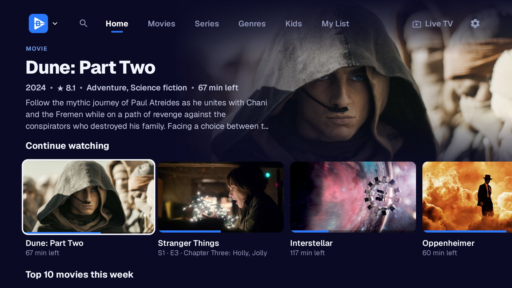
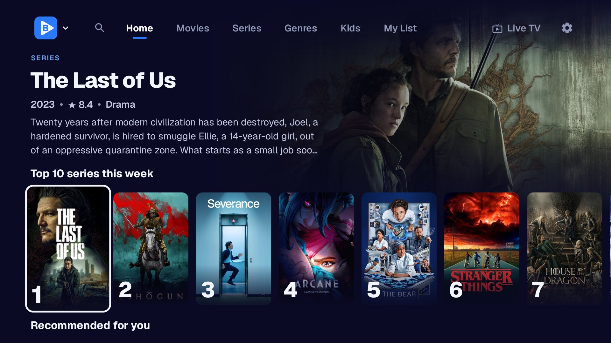
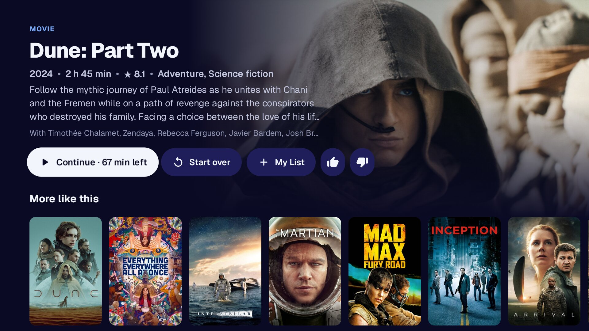
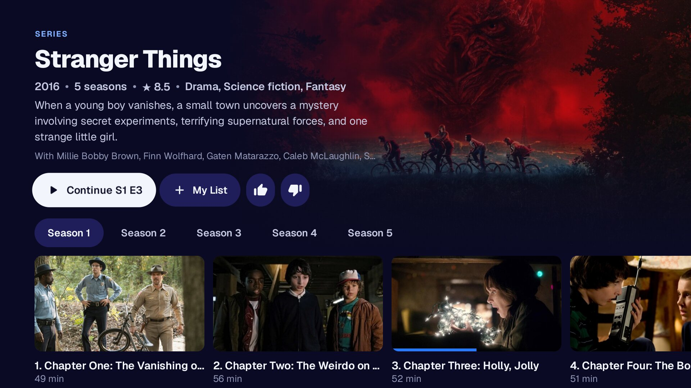
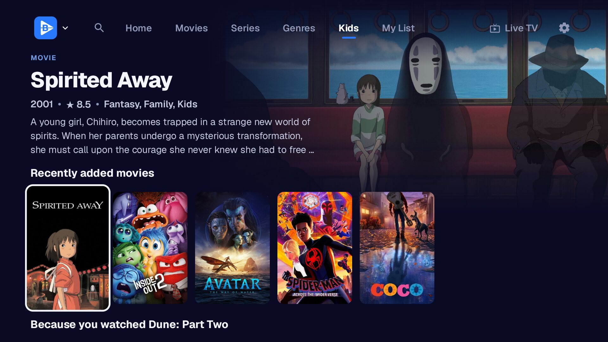

# BoschTV

A TV app for Android TV and Google TV (Chromecast with Google TV) that turns an IPTV subscription
into something that feels like a real streaming service. Films and series are presented like Netflix:
one catalog with real genres, streaming-service shelves, continue watching and recommendations.
Live TV behaves like a TV, with zapping, a channel list and a timeline guide. The provider's hundreds
of categories are never shown; the app reads them and builds proper pages from them.

| | |
| --- | --- |
|  |  |
|  |  |

BoschTV contains no content and no provider. You log in with your own Xtream Codes subscription
(server, username, password), the login nearly every IPTV provider gives out.

## Install

On a Google TV, without a computer:

1. Install **Downloader** from the Play Store.
2. Settings → System → About → press *Android TV OS build* seven times (turns on developer options).
3. Settings → Apps → Security & restrictions → Unknown sources → switch on **Downloader**.
4. Open Downloader, type the code **9379736** in the address field and press Go. Confirm the install.
   (Without the code: `https://github.com/boschtv/boschtv/releases/latest/download/boschtv.apk`)
5. Open BoschTV and log in, on the TV or by scanning the QR code with your phone.

New versions are offered by the app itself (Settings → Check for updates).

## What it does

- **One catalog.** The same film listed in ten categories, three languages and four qualities becomes
  one title, in your language when it exists, with the other versions selectable.
- **Your language.** Choose it in Settings (new installs start in the TV's own language). English
  is the fallback; every other language is left out. Works with the usual ways providers label things:
  `┃NL┃`, `[DE]`, `FR:`, `Movies | EN`, "Dutch Movies", "Turkse series".
- **Home, Films, Series, Kids** with rows ordered by your taste, the time of day and the season; Top 10
  and "new and popular" per streaming service from TMDB.
- **Services.** Pick a service from the logo top left; the whole app then shows only that service's
  titles.
- **Genres** with combinable filters for kind, year and sort order.
- **Player.** Resume, next episode with countdown, subtitles and audio tracks, fast skipping.
- **Live TV.** Last channel on start, up/down zapping, number keys, channel lists, favourites, a
  timeline guide (press ▶), and watching a programme from its beginning where the provider allows it.
- **Search** with an on-screen keyboard or your voice.
- **Private.** Your history, list and progress stay on the TV. The app talks only to your provider,
  to TMDB (posters, trending lists) and to GitHub (update check).

The app's own texts are Dutch for now; see the roadmap.

## Working on it

[CONTRIBUTING.md](CONTRIBUTING.md) walks through building, running on an emulator or your TV, how the
catalog is read, and how to make the app understand a provider or a language it does not handle yet.
Plans are in [ROADMAP.md](ROADMAP.md).

## Notes

- Streaming-service names and logos are trademarks of their owners, used only to label which service
  a title belongs to. The logos are loaded from TMDB at runtime; this repository contains none.
  BoschTV is not affiliated with any of these services.
- This product uses the TMDB API but is not endorsed or certified by TMDB. Streaming-service data by
  JustWatch.
- Licenses of the software BoschTV is built with: [THIRD_PARTY_NOTICES.md](THIRD_PARTY_NOTICES.md).
- You are responsible for the subscription you use with it.

## License

[MIT](LICENSE)
